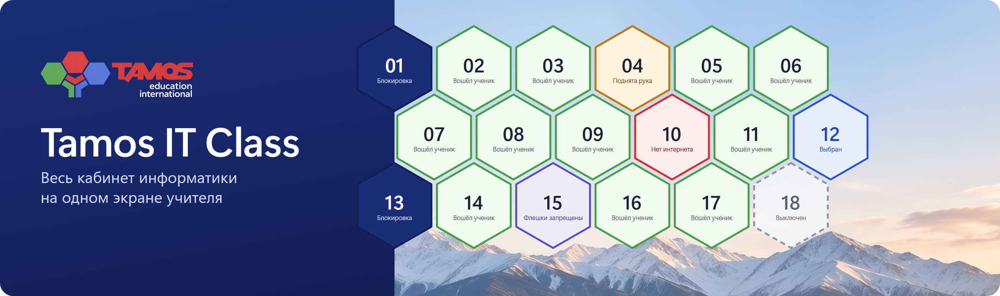
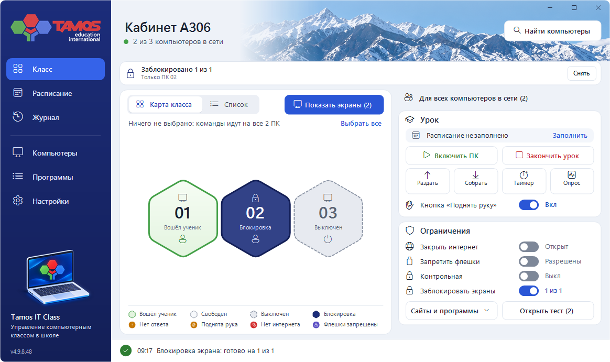

  

Tamos IT Class помогает учителю вести урок в компьютерном классе: показывает весь кабинет на одном экране,
блокирует экраны, раздаёт задания и управляет интернетом на компьютерах учеников.

Разработчик: **Тилегенов Айдос Жанатулы**, Tamos Education.

  

Здесь лежат только выпуски программы. Установленные компьютеры обновляются отсюда сами и ставят только выпуск с верной цифровой подписью.

## Установка в кабинете

Программу в новом кабинете устанавливает разработчик. Чтобы подключить кабинет, позвоните по номеру ниже.

## Поддержка

Тилегенов Айдос Жанатулы, +7 776 006 00 26.

## Лицензия

Программа включает компоненты [Veyon](https://veyon.io) 4.9.8 (© Tobias Junghans / Veyon Solutions) по лицензии [GNU GPL v2](COPYING). Исходный код этих компонентов можно получить по запросу у разработчика.